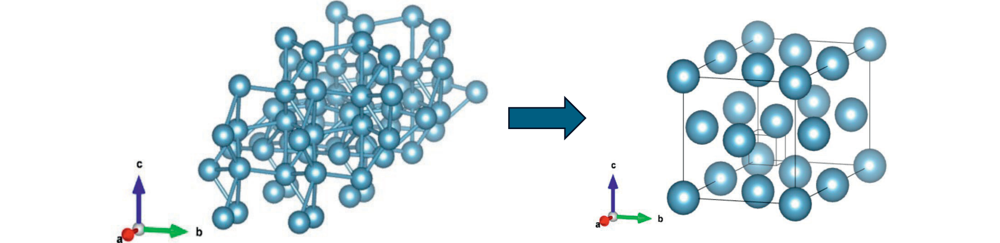
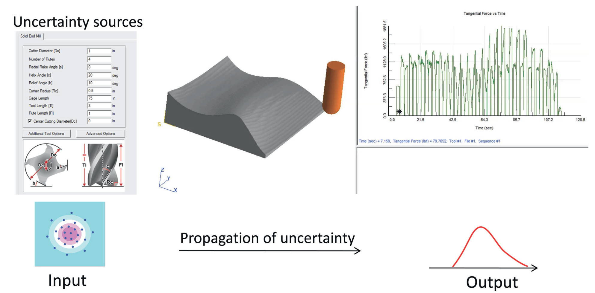
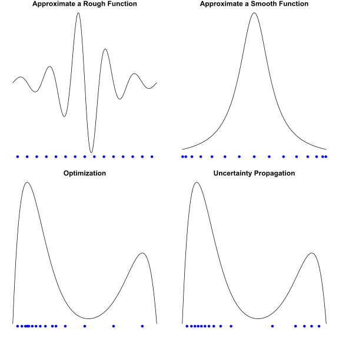

```{=latex}
\part{Introduction}
```

# Experiments

## Overview

An important task in science and engineering is to develop a relationship between the inputs and outputs of a system. The “System” that we are interested in could be very general and may refer to a rocket engine, a machining process, or even a human brain. The inputs, for example, in a machining process, could be the speed of machining or a specific angle of the cutting tool, while the outputs could be the force on the tool or the temperature on the workpiece.

An approach to build the input-output relationship (also known as the response surface) is to collect data from the system and develop the relationship using statistical and machine learning methods. When data is expensive and resources are limited, we need to be careful about the data collection process so that we can obtain “useful” data with minimum cost and time. Performing carefully planned experiments on the system is one way to do this. Here an experiment refers to making purposeful changes to the inputs and observing the outputs as opposed to an observational study, where we simply observe both inputs and outputs without making any changes to the system. An experimental design is a plan for doing such an experiment, which prescribes where and how to collect the data from the system.

Another approach to build the input-output relationship is to use the physical laws governing the system (such as Newton’s laws) and derive the relationship. One may think that with such an approach we do not need data or experiments, but that is not true! The physicsbased models may contain unknown constants (such as friction coefficient), which can be specified only if we have data from the physical system. Moreover, the physics-based model may not be an easy-to-evaluate analytical function and may require sophisticated numerical methods, such as finite element methods for solving the underlying mathematical model, which could be a system of partial differential equations. The numerical implementation of the solution procedure on computers is usually known as a computer model or simulator. Since the computer model is computationally expensive, we again need to carefully plan the computer experiments. Thus, experimental designs are important in this context as well, but “how” to do the experiments becomes irrelevant and we only need to be concerned with “where” to do the experiments.

In some cases, a combination of the foregoing two approaches may be needed to fully develop the input-output relationship. For example, the investigator may not have full understanding of the system and may be able to develop a physics-based model that is only partially correct. This situation is very common, as most engineered or biological systems are very complex and difficult to model completely using physics. Therefore, we will also need to collect data from the physical system to correct for the bias due to missing physics and to calibrate the computer model. This will require both a physical experiment and a computer experiment.

## Applications

Once the input-output relationship is developed, it can be used for many purposes, such as optimizing or controlling the system. Below are a few real examples.

Krishna et al. (2024) were interested in finding stable crystal structures. However, creating materials in a lab with different crystal structures and investigating their stability is tedious, expensive, and time consuming. Crystal structures that are found in nature are known to have low potential energy. Therefore, a more feasible approach would be to compute the potential energy of a crystal structure using Density Functional Theory (DFT) and find the optimal atomic configuration that minimizes the potential energy (Figure 1.1). Although this computational approach is cheaper, it is still not an easy problem because DFT computations are expensive and the atomic space to explore is huge. To add to that complexity, the potential energy surface can have many local minima (e.g., graphite and diamond are different configurations of carbon atoms). Experimental design techniques can be used to efficiently search the huge atomic space and find the global optimum with minimum number of DFT computations.



Huang et al. (2021) described the problem of making hybrid membranes for chemical separations. Metal particles are infused into a polymer membrane to make hybrid membranes so that they do not easily dissolve during the chemical separation process. This is done using a vapor phase infiltration process. Ren et al. (2021) developed a reactiondiffusion model to predict the amount of metal particles trapped in the polymer membrane. However, this model has five unknown parameters (such as diffusion constants) that need to be specified before the model can be used for prediction. They can be estimated from the real data shown as a black solid line in Figure 1.2. This is a model calibration problem, but cannot be easily solved using the usual nonlinear regression techniques because here the computer model is expensive to evaluate. Therefore, experimental design techniques are necessary to efficiently solve this problem.

![Calibration of reaction-diffusion model in a vapor-phase infiltration process. The real data is shown as a black solid line and three model evaluations as dashed lines. Reprinted with permission from Yi Ren, Emily K. McGuinness, Chaofan Huang, V. Roshan Joseph, Ryan P. Lively, and Mark D. Losego (2021). “Reaction–Diffusion Transport Model to Predict Precursor Uptake and Spatial Distribution in Vapor-Phase Infiltration Processes”. In: Chemistry of Materials 33(13), 5210–5222. Copyright 2021 American Chemical Society.](../figures/1.2.png)

Gul et al. (2018) reported a problem faced by a machining software company. The right side of Figure 1.3 shows the tangential force acting on the tool over time in a solid end milling simulation. Some of the inputs that can be varied in the machining software console are shown on the left side of the figure. The simulator is deterministic; that is, it will give the same output of tangential force for the same input settings. However, in reality, the tool wears out and the material properties change from piece to piece. Therefore, the output force will not be exactly as predicted and will have some variability depending on the state of the tool and the material. The software company would like to add a confidence interval to the prediction to capture the uncertainty in the inputs. A simple way to construct this confidence interval is to use Monte Carlo (MC). That is, we can draw random samples from the distribution of the inputs and then run the simulator to produce a collection of the output curves from which we can obtain, say, the 95% confidence intervals. This confidence interval will be accurate if we use a large number of MC samples. However, this is inefficient because the simulation is not cheap to run. We can use experimental design techniques to optimally sample from the input distribution and propagate the uncertainty, thus saving the simulation time.



The objectives of the aforementioned examples are different: The first problem on crystal structures is about optimization, the second problem on membranes is about calibration, and the third problem on machining is about uncertainty propagation. There is no single optimal experimental design solution to all these problems. In fact, the optimal experimental design differs depending on the objective and the type of response surface. Figure 1.4 illustrates several examples using one-dimensional functions. For example, suppose that the objective is to approximate the response surface. If the response surface is rough, then a design that uniformly fills the space is good (top left panel of Figure 1.4); whereas, if the function is smooth, then a design that places more points near the boundary is good (top right panel). If the objective is to maximize a function, we should place more design points near its global maxima (bottom-left panel). On the other hand, if the objective is to propagate uncertainty, the design points should be placed in such a way as to mimic the distribution of the input (bottom right panel with function depicting the density of input).



An experimental design specifies where the data needs to be collected. Therefore, when trying to find the optimal experimental design, we do not have any data with us. In other words, we do not know anything about the response surface when designing the experiment. But Figure 1.4 shows that the optimal experimental design depends on the underlying response surface (except for the last case). Thus, finding the optimal experimental design seems like an ill-defined problem. Fortunately, there is one way to get around this issue. We do not need to specify all the design points beforehand. We can start with an initial design, collect data, and then decide where to do the next experiment. This is called a sequential design approach (also known as active learning in machine learning literature). As far as the initial design is concerned, the uniformly spread points shown in the top left panel of Figure 1.4 seem like a good strategy. This is called a space-filling design and will be discussed in detail in a later chapter.

## Role of Uncertainty

If we know everything about the underlying response surface, then we do not need to collect data or need any experiments. It is the uncertainty about the response surface that forces us to perform experiments and collect data. The data bring us new information and reduce our uncertainty about the response surface. Thus, it makes sense to perform experiments that maximize information or minimize uncertainty. As shown in Lindley (1956), the theory of optimal experimental design can be formulated using concepts from information theory (Shannon, 1948). However, we can develop most of the experimental design techniques discussed in this book without delving into information theory as long as we have a way to quantify uncertainties. We will quantify the uncertainties using some statistical modeling techniques.

To discuss about modeling techniques, we need to first introduce some notation. Let $\boldsymbol{x}=\left(x_1,\dots,x_p\right)'$ be the $p$ inputs (also known as factors) and y be the output (or response). There could be many outputs, but in most cases it is enough to develop the modeling techniques for multi-input/single-output system, which can be separately applied on each of the outputs. Assume the statistical model

$$
y=h\left(\boldsymbol{x}\right)+\varepsilon,\tag{1.1}
$$

where $h\left(\boldsymbol{x}\right)$ is the input-output relationship (response surface) and $\varepsilon$ is the random error caused by changes in numerous other factors that might affect the output but not considered in the experiment. In a physical experiment, $\varepsilon$ will also include the measurement errors caused by the instrument. If the experiment is performed using a deterministic computer model, we can ignore the term $\varepsilon$. It is common to assume $\varepsilon\sim\mathcal{N}\left(0,\sigma^2\right)$, where $\sigma^2$ is the variance of the random error. The normality assumption and the additive error assumption in (1.1) may not be valid, and some transformations may be needed to make it work in practice (Box and Cox, 1964).

Suppose that we performed an experiment with one factor at two values (also known as levels): $x=0$ and $x=1$ with three replicates. Data are shown as solid blue circles in Figure 1.5. Assume $h\left(\cdot\right)$ to be the function shown as a black solid line in the figure, but unknown to the experimenter. Linear regression models are commonly used in physical experiments (Wu and Hamada, 2021). Suppose that we fit the model $y_i=\beta_0+\beta_1x+\varepsilon_i$ to the data, where $\varepsilon_i\overset{iid}{\sim}\mathcal{N}\left(0,\sigma^2\right)$, for $i=1,\dots,n$ (here $n=6$). The fitted line along with $95\%$ confidence intervals are shown in the left panel of the figure. Gaussian process (GP) regression (Rasmussen and Williams, 2006) is rarely used in this context, but is also shown in the right panel of the same figure.


Although the predictions from both the linear and GP regressions are approximately the same, the prediction intervals are completely different. This is because of the way these two types of model quantify the prediction uncertainties, and it is important for us to understand their differences. The uncertainty of linear regression prediction includes the uncertainties in the estimated parameters ($\widehat{\beta}_0$ and $\widehat{\beta}_1$) and the random error ($\varepsilon$). The uncertainty is highest at the extremes ($x=0$ and $x=1$) and smallest at the middle ($x=0.5$). On the other hand, GP regression is a nonparametric regression method. Therefore, its prediction uncertainty includes the uncertainties about the function $h\left(\cdot$ and the random error. It has minimum uncertainty where we have observed the data and maximum uncertainty in the middle. This is completely opposite of linear regression!

Clearly, the uncertainty estimate from the GP regression makes more sense than that of the linear regression. The GP regression uncertainty estimate would suggest that we perform the next experiment in the middle, which will give us more information about the true function. On the other hand, the linear regression uncertainty estimate would suggest that we continue to perform experiments at extremes. This is because the linear regression uncertainty estimate is obtained by assuming that $y=\beta_0+\beta_1x$ is the true model. Thus, not being able to capture the uncertainties in the model is a major weakness of the linear regression approach.

Most of the experimental designs on physical experiments are developed by assuming linear regression models (Box et al., 1978; Montgomery, 2017; Wu and Hamada, 2021). Does this mean that they are not useful? Not really! When the number of factors ($p$) is high and when the number of experiments ($n$) is small, the GP regression will also give larger uncertainties at the boundaries coinciding with the results of the linear regression. Most physical experiments are of this kind (large $p$ and small $n$); therefore, using a linear or GP regression framework would likely produce identical results. However, relying on the linear regression framework does impose some limitations in our quest for optimal designs.

Suppose that we have six continuous factors to experiment and a budget of about $30$ experiments (also known as runs). One could consider a two-level fractional factorial design $2^{6-1}$, which requires $32$ runs. Alternatively, we could consider using a three-level fractional factorial design $3^{6-3}$ which requires $27$ runs or a central composite design with $29$ runs ($12$ axial points, $16$ cube points, and $1$ center point). The literature on experimental design is not clear on which of these designs should be used. This is because each of them assumes a certain linear regression model and does not entertain the possibility of misspecifications of the model. The need to obtain designs that are robust to model misspecifications has long been recognized in the literature. However, the inability of linear regression models to fully capture the model uncertainties limits their usefulness. For example, one can obtain a $2^{6-1}$ minimum aberration design (Fries and Hunter, 1980), which is considered to be a model robust design (Cheng et al., 1999). However, it is robust only to a linear regression model that includes linear effects, and two-factor and higher-order interactions; it does not consider the possibility of nonlinear effects.

The foregoing discussion suggests that we would be better off developing the optimal design framework using GP regression than linear regression because of GP’s ability to better quantify model uncertainties. This is the approach taken in this book.

## Outline of the Book

Due to the reliance of GP models in many of the experimental design techniques discussed in the book, we will start with a gentle introduction to GP modeling in Chapter 2. However, before introducing GP, we start with the more familiar polynomial interpolation and then transition slowly to GP after a gentle introduction to radial basis functions and kriging. Extensions of these approaches to noisy data are also discussed, which become essential for the methods in Parts II and IV. Some important concepts in experimental design are also introduced during their discussion.

Part II of the book starts with GP-based experimental design methods. Chapter 3 is short because those methods are not very useful in practice because of their dependence on unknown hyperparameters of the GP model. However, Chapter 3 forms the basis for developing the more practical and useful experimental design methods in Chapters 4–7. Chapter 4 discusses some of the key concepts of the book on space-filling designs, which are motivated as the limiting cases of GP model-based designs, but also possess geomet- rical interpretations. They can be considered as model-robust designs, and thus useful for practical applications. Chapter 5 extends these ideas to non-uniform distributions, which lays the foundations for the data science methods discussed in Part IV. Chapter 6 discusses a very useful special case of space-filling design where the interest is in quickly screening factors. This chapter also introduces some useful concepts from global sensitivity analysis that form the basis for variable selection techniques discussed later in Chapter 11. Chapter 7 develops sequential design methods to achieve a specific objective, such as optimization, where the designs from Chapters 4 to 6 can be used as initial designs.

Chapter 8 in Part III on fractional factorial designs is kept intentionally short because of the availability of many excellent textbooks on this topic. However, this chapter can still be interesting to the readers because it tries to connect with many of the experimental design and modeling methods introduced in Parts I and II. Chapter 9 discusses the case where we have data from both computer and physical experiments.

Part IV shows the application of experimental design methods in subsampling (Chapter 10) and data analysis (Chapter 11). Experimental design is traditionally viewed in statistics as a technique for data collection and planning. This part is included in the book to create an appreciation of the broad applicability of design of experiments and reinforce it as a foundational topic of statistics.
